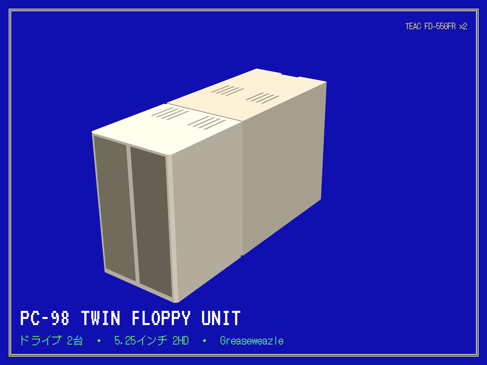

# PC-98 Floppy Station

A 3D-printed twin 5.25" floppy drive unit for NEC PC-98 disks, and the software
that lets an emulator play straight from the real drives.

Two TEAC FD-55GFR drives and a Greaseweazle V4 go into one printed box. Plug it
into any computer over USB and you can read, write and copy PC-98 disks, or run
a game in an emulator with the disks still in the drives, swapping them when the
game asks, the way the real machine did.

## The box

- Two layouts from the same model: **side by side** (drives on edge, like the
  PC-80S31 and X68000 drive units, 102.4 x 157.0 x 285 mm) or **stacked**
  (drives flat, like a PC-9801 desktop, 159.0 x 99.8 x 285 mm).
- Two shell halves that push together and click, a snap-on rear door with a notch
  for the USB-C cable, the Greaseweazle on the floor behind the drives on captive
  nuts, and recesses for rubber feet. No brackets, clamps or glue.
- Two fit-test rings so the drive openings can be checked in about an hour before
  the big parts are printed.

Files: [`print/`](print/) holds the ready-to-print STLs for both layouts and the
[print README](print/README.txt) with slicer settings and the size table.
The same pack is on [Cults3D](https://cults3d.com/:5146826).
[`pc98_disk_unit.scad`](pc98_disk_unit.scad) is the OpenSCAD source.

Parts to buy, with links: [PARTS.md](PARTS.md).

## Download

One file per system, nothing else to install except the disk driver. Latest version:

| | Download | Disk driver | First start |
|---|---|---|---|
| Windows | [pc98-floppy-station-windows.exe](https://github.com/aleitner/pc98-floppy-station/releases/latest/download/pc98-floppy-station-windows.exe) | [WinFsp](https://winfsp.dev/rel/) | Windows may warn about an unknown publisher: *More info*, then *Run anyway*. |
| macOS | [pc98-floppy-station-macos.zip](https://github.com/aleitner/pc98-floppy-station/releases/latest/download/pc98-floppy-station-macos.zip) | [FUSE-T](https://www.fuse-t.org/) | Unzip, then right-click the app and choose *Open* the first time. |
| Linux | [pc98-floppy-station-linux](https://github.com/aleitner/pc98-floppy-station/releases/latest/download/pc98-floppy-station-linux) | `fuse3` from your distribution | `chmod +x pc98-floppy-station-linux`, then run it. |

Plug the unit in, start the program, and a window opens. The first time, put a disk in
the **left** drive only and press *Check*, so it learns which drive is which. After that:
*Start*, then *Play*. All releases: [releases](https://github.com/aleitner/pc98-floppy-station/releases).
The Windows and Mac files are built by GitHub and have not been tried on a real machine yet.

## The software

Reading, writing and copying disks is done with the
[Greaseweazle host tools](https://github.com/keirf/greaseweazle) themselves.
What this repository adds is **the bridge**: it shows the two real drives as disk
image files (`FD1.hdm`, `FD2.hdm`) that an emulator opens like any other image. Reads
come from the drive on demand, writes go back to the disk a moment later, and a disk
swap is noticed by the drive's own disk-change line.

[`app/station.py`](app/station.py) is the window for it: it shows the board and both
drives, a Start button, the two files, and a Play button when RetroArch with the
PC-98 core is installed. [`app/floppy_bridge.py`](app/floppy_bridge.py) is the bridge
itself, which the window runs for you. It needs a FUSE driver: libfuse on Linux,
WinFsp on Windows, FUSE-T or macFUSE on macOS. Setup and use: [app/BRIDGE.md](app/BRIDGE.md).

The bridge is proven on Linux with RetroArch's Neko Project II kai core: a game
boots from the real drives and reads correctly from both. Saving back to a disk,
swaps during play, Windows and macOS have not been tested yet. It includes no
emulator and no BIOS files; bring your own.

## What protects your disks

- **The notch.** A covered write-protect notch is enforced by the drive itself, in hardware.
  The bridge also shows such a disk as a read-only file, so an emulator never tries.
- **No write before track 0 decodes.** The first write to a disk is only accepted after the
  drive has read the disk's track 0 with the sector headers the decoder expects. A drive
  whose home position has slipped fails that test and is refused, instead of writing every
  track to the wrong place.
- **Every write is verified.** Each track written is read back; if it doesn't match, the disk
  is marked broken and no more writes go to it.
- **A swap drops pending writes.** Changes that haven't reached the disk yet are never written
  to a disk that was swapped in underneath them, and the window says so.
- **Only what the game writes.** The bridge writes tracks the emulator changed, nothing else.
  Backup only reads.

What software can't protect against is a dirty or damaged head, which scratches a disk in
a few passes. That part is on you, below.

## Before an original disk goes in

Old drives arrive with decades of oxide on their heads, and a dirty head scratches
disks. Clean both heads with 90 % or stronger isopropyl alcohol and let them dry,
run a write-and-read test on a blank, and only then insert anything irreplaceable.
Read an original once, keep the image, and play from a copy.

## Licence

The enclosure model, STL files, pictures and guides: [CC BY-NC-SA 4.0](LICENSE-MODEL.md),
free to print and share with credit, not for sale.
The software: [MIT](LICENSE).
